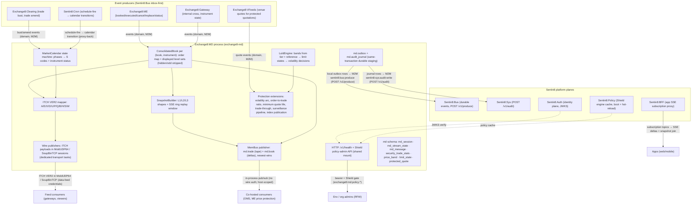

# README.md: Exchange8:MD

## 1. Summary

Exchange8:MD (`services/md/`, binary `exchange8-md`, service_type `exchange8:md`) is the
consolidated market-data publisher of the exchange8 vertical (the capital-markets
tier of the Sentin8 platform). It consumes matching-engine order/trade/status
events and produces every market-data surface: the per-(book, instrument)
consolidated depth book mirrored from matching-engine events, ITCH VER2 wire
messages for each delta, L1/L2/L3 snapshot shapes, the SSE delta + snapshot
application feed through the BFF subscription path, bust/amend fan-out from
Clearing, the `S` System Event stream driven by the trading calendar, and the
LULD limit-up/limit-down band engine with volatility-intervention decisions.

The event pipeline is a set of pure Rust modules (`services/md/src/book.rs`,
`calendar.rs`, `luld.rs`, `snapshot.rs`, `protection.rs`): pure transformers
with no clock, no tokio, and no database dependency. The service binary wraps
them in the Sentin8 platform shell (`sentin8::shell`): axum HTTP/TLS surface,
`--print-registration` self-registration, DB pool, health endpoint, the Shield
termination. MD is a pub/sub-class publisher on Sentin8:MemBus: it publishes the
`md.trade` (tape) and `md.book` (deltas) families, newest-wins. Durable event
delivery rides the platform planes: the local `md.outbox` relays to
Sentin8:Bus and `md.audit_journal` pushes to Sentin8:Sys.

## 2. Motivation

- **One publication point per delta.** Exchange8:ME owns order state, Exchange8:Clearing owns
  trade settlement state; neither should be reachable by feed consumers. A single
  market-data publisher mirrors engine events into the display book so every
  consumer (gateway, OMS, app UI, external subscribers) sees exactly one
  consolidated tape instead of per-service re-derivations.
- **Wire compatibility at the outbound edge is a contract.** The ITCH VER2 byte
  layouts (type chars `A`/`E`/`X`/`D`/`U`/`P`/`Q`/`B`/`H`/`S`/`W`), MoldUDP64
  framing, and SoupBinTCP session login are platform contracts with dedicated
  codecs (`crates/itch`, `crates/mold`, `crates/soup`); market data must
  reproduce them exactly, message for message.
- **Depth is display policy, not raw book state.** Hidden orders never print an
  add; odd-lot volume is stripped from displayed depth (board part only);
  replace is kill + add internally but a single `U` on the wire. These rules live
  in one mapper so the display book is a first-class invariant, not an
  emergent property of N viewers.
- **Late joiners need a join point.** A snapshot with its sequence cursor plus a
  bounded replay window lets a reconnecting client either catch up from deltas or
  take a fresh snapshot - no client-side reconstruction from raw wire dumps.
- **Market-state truth must be a machine, not a schedule script.** Preopen →
  open-auction → continuous → close-auction → post-close, plus halt/resume, are
  a state machine consuming calendar transitions and emitting `S` codes and
  instrument-status effects; the alternative (a Cron script mutating flags)
  cannot express invalid transitions, replays, or idempotency.
- **Protection is data, not a side effect.** LULD bands, limit states, and
  protected quotes are queryable market data - every consumer (ME price
  protection, OMS pre-trade checks, risk, apps) reads the same band/state
  surface instead of recomputing its own.
- **No bespoke infrastructure.** Identity, TLS, policy administration, event
  durability, audit delivery, and scheduling are platform services (Sentin8:Auth,
  `sentin8-tls`, Sentin8:Policy via Shield, Sentin8:Bus, Sentin8:Sys,
  Sentin8:Cron); the binary only owns the market-data domain.

## 3. Architecture & High-Level Design

The core is **event-driven and pure**: engine events enter the consolidated-book
mapper and the snapshot builder, which produce ITCH wire bytes and SSE delta
shapes. The wire publishers (MoldUDP64, SoupBinTCP) are dedicated transport
tasks per the published session model; the HTTP surface carries health and the
Shield policy-admin API. The calendar state machine and the LULD engine sit
beside the book as first-class domain objects.

The data flow per mechanism:

- **Book publication** - an ingested ME/Gateway event updates the
  per-(book, instrument) consolidated mirror, which emits the ITCH VER2 byte
  messages for the delta and the SSE delta for the app feed.
- **Snapshots** - the `SnapshotBuilder` maintains per-instrument state with a
  strictly increasing `seq`; `GET`-grade snapshot shapes and SSE delta lines
  render from the same in-memory state, and the replay window answers
  `Last-Event-ID` resumption.
- **LULD / protection** - the band engine computes upper/lower from
  `tier × reference`, classifies prints and orders, and hands
  halt-and-auction decisions to the volatility-auction arc.
- **Calendar** - the phase machine consumes calendar transitions (from
  Sentin8:Cron schedule-fire) and emits `S` codes plus instrument status.

## 4. Key Traits and Data Structures

- **Consolidated book (`ConsolidatedBook`)** - per-(book, instrument) mirror holding
  the resting-order map (price, qty, side, hidden, odd flag) and the two ordered
  displayed-level sets (bids descending, asks ascending). Feeding one engine
  event returns the wire messages for that delta in a fixed order; hidden
  orders produce no add, odd portions never add displayed depth, and replace is
  an internal kill + add that emits a single `U`.
- **ITCH VER2 outputs (`ItchOut`)** - message type char plus the encoded VER2
  payload (type byte included). Fixed lengths come from `exchange8::itch`
  constants; the instrument id on the wire is a u16 field width (`itch_instrument_id`).
- **Bust/amend fan-out (`BustFanout`)** - ordered variant list per Clearing bust
  (trade-cancel, broken-trade marker, book-level restore) or amend
  (cancel → restore original → corrected print → consume corrected volume).
- **Calendar state machine (`MarketCalendar`)** - `Closed → PreOpen →
  OpenAuction → Continuous → CloseAuction → PostClose → Closed` with halt/resume
  edges and an instrument-status projection per phase (Open / QuotationOnly /
  Halted). Invalid transitions are no-ops; emitted `S` codes drain in order.
- **LULD engine (`LuldEngine`)** - tiers map to band widths in basis points
  (±5% / ±10% / ±20%), bands are computed from the reference price, prints
  classify into `LimitUp` / `LimitDown` / `None`, and the order gate blocks
  the wrong-side direction while restricting prices to inside the band.
- **Snapshot builder (`SnapshotBuilder`)** - per-instrument L1/L2 state with a
  monotonically increasing `seq` (one bump per applied event), a bounded
  `VecDeque` replay ring (`replay_window`), and the resync predicate
  (`needs_resync`) that forces a fresh snapshot when the cursor falls out of
  the window. Deltas are `Add` / `Reduce` / `Delete` / `Trade`, each with an
  SSE rendering whose `id:` is the sequence cursor.
- **Protection extensions (`protection.rs`)** - the volatility-auction arc
  (`Continuous → Halted → Call → Resuming → Continuous`), the per-connection
  order-to-trade-ratio guard with grace trades, the minimum-quote-life
  anti-spoofing guard, trade-through verdicts against the protected quote, the
  surveillance alert pipeline (observations → detectors → alerts → escalated
  cases), index divisor rebalancing and publication gating, conformance
  scenario runners over session logs, order-state reconstruction from journal
  events, crypto corporate-action crediting, and crypto feed event shapes.

## 5. Rationale, Trade-offs, and Alternatives

- **Event-derived mirror instead of reading the engine's own book.** MD derives
  a display mirror from the event stream it consumes; the alternative (reading
  the matching engine's in-memory or persisted book) would couple two services
  at the storage layer, violating the direct-access rule. The mirror is a
  projection with an exactness invariant (property-checked against the engine's
  book in tests).
- **BTreeMap level sets, not vectors.** Levels need ordered iteration (best
  first for BBO; ascending/descending renders for depth) plus O(log n)
  aggregation and removal at zero volume. A vector + resort per event would
  turn every delete into a linear scan; a heap + a separate level map would
  duplicate bookkeeping. The tree keeps the hot path single-structure.
- **Newest-wins MemBus families (`md.trade`, `md.book`).** Book deltas and
  trade prints are superseded states: a consumer holding the latest book or
  tape needs no history; a consumer needing history subscribes to the durable
  Bus stream instead. That is why MD publishes MemBus state (host-scoped,
  in-process) for co-hosted consumers and outbox→Bus for durable domain events;
  the two planes answer different delivery contracts.
- **Pure core with the shell as the only I/O surface.** Every domain module is
  a pure struct/free-function module testable without tokio or a database;
  in-binary `#[cfg(test)]` runs without a service bootstrap. The cost is that
  the axum wiring is thin and mostly shared (health, policy admin, SSE glue) -
  accepted, because market-data logic must be golden-byte-testable.
- **Display policy upstream of the snapshot.** Hidden/odd stripping happens in
  the book mapper, so snapshots and SSE deltas only ever see displayed volume.
  The alternative (strip per consumer) would re-implement board policy in every
  surface and drift.
- **Randomized uncross via a deterministic per-day seed** - an xorshift
  derivation from a day seed and the window; the anti-gaming randomness is
  reproducible for an ops replay, unlike wall-clock entropy.
- **Rejected: client-side book reconstruction from raw Mold/ITCH dumps as the
  primary app feed.** The `Snapshot` + `SseDelta` contract exists precisely so
  apps never parse ITCH; feed parity stays with the dedicated wire consumers.

## 6. Internal Implementation & Invariants (Private Design)

- **Invariant: hidden orders never add displayed depth.** The order map records
  `hidden: true` entries; every level mutation path
  (add / execute / reduce / delete / replace) checks `was_displayed =
  !hidden && !odd` before touching the level set. Test: `hidden_add_no_message`,
  `hidden_execution_no_e_but_no_level_hit`.
- **Invariant: level sets are the single source of displayed volume.** Every
  mutation adjusts exactly one `BTreeMap<i128, u64>` (keyed by `price.raw`)
  and removes the level at zero. `depth()` renders bids descending, asks
  ascending directly from the trees.
- **Invariant: snapshot `seq` increments exactly once per applied event.**
  `bump()` is the only sequence writer; a single execution bumps twice by
  design (the level mutation plus the trade print are two deltas). The
  snapshot carries the sequence of the last applied event; `deltas_after` and
  `needs_resync` define the resumption contract; the ring is bounded and
  trimmed oldest-first.
- **Invariant: bust/amend fan-out order is cancel → corrective print → book
  restore.** Consumers apply the list in order; the amend path restores the
  original volume before re-consuming the corrected volume (zero-qty negative
  restore models the consume).
- **Invariant: the calendar transition table is total.** A transition not
  matching the session arc is a no-op (idempotent replay), and
  `post-close → closed` is the only path that emits end-of-messages.
- **Invariant: band edges are inclusive.** A print at the exact upper/lower
  band is a limit state, not merely an observation; `order_allowed` enforces
  direction gating (limit-up blocks buys, limit-down blocks sells) plus an
  in-band price for the order itself; an unconfigured instrument is
  unrestricted (configuration is the shell's gate, not the engine's).
- **Invariant: the replay window is the only delta memory.** `deltas_after`
  never synthesizes events; a cursor older than the window's first entry is a
  resync, not a reconstruction.
- **Policy evaluation parity.** The registered scope-mirror set
  (`registration::SCOPE_MIRROR_POLICIES`) is the exact Shield text of the
  handler gates; the wiring tests assert every handler action
  (`exchange8:md:stream`) is covered by the mirror, that a tenant-authored
  forbid beats the platform permit, and that an M2M token type never bypasses
  the evaluation.
- **Sequence state lives off the hot path.** `md_stream_state` rows carry the
  per-session outbound sequence for gap detection and resend; the in-memory
  book never round-trips to PostgreSQL on the publish path.

## 7. Unresolved Questions / Future Designs

- **HTTP data-plane endpoints.** The design doc specifies snapshot, replay,
  per-book directory, and market-status REST paths plus the BFF subscription
  surface; the current binary mounts health and the Shield policy-admin API
  with publication running on dedicated transport tasks. Whether the snapshot
  service is mounted as axum routes in this binary or materializes as a
  BFF-adjacent publisher is an open wiring question (pure core is complete).
- **Multicast transport posture.** MoldUDP64 A/B legs, SoupBinTCP
  login-with-seq sessions, and the unicast retransmission endpoint are
  transport-level concerns of the published session model; per-consumer
  data-feed credential rotation and the replay retention window (Sentin8:Storage
  rings per stream/hour) are not yet expressed in this unit's sources.
- **B-leg and cross-shard ordering.** The design doc's 1 ms snapshot throttle
  for multicast bursts and the sharding scheme (`instrument_id % N` shard
  tasks) are described at the architecture level; the unit currently owns the
  per-(book, instrument) core without a shard-table policy in sources.
- **Protected-quote feed contract.** `protected_quote` rows are "fed by VFeeds
  CBBO events"; the exact event name and field contract from VFeeds is owned
  by that unit's design, not verified here.
- **Index publication consumption.** `IndexPublication` is consumed by
  margin/funding per the index-engine design; the durable topic and the
  minimum-change default are open to that unit's event contract.
- **Surveillance detector set.** The pipeline accepts arbitrary detector
  closures; the production detector configuration (which detectors ship
  enabled per env) belongs to the surveillance unit.

---

**Design attribution:** exchange8:md and its underlying concepts were designed by Hamid Jahanzad <Hamid@Jahanzad.com>.
